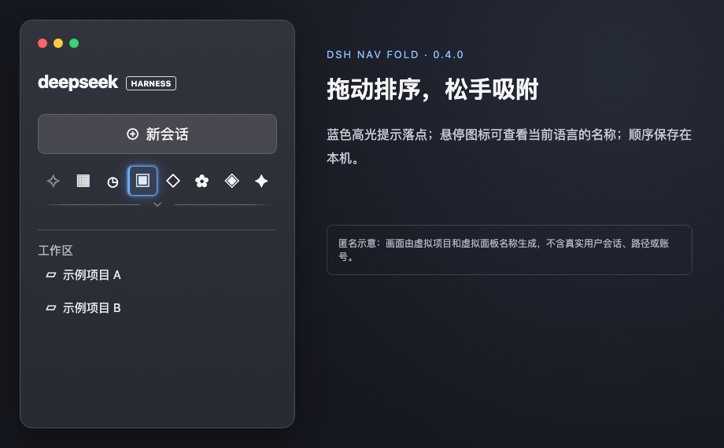

# dsh-nav-fold · DSH 全局面板折叠

适配 DeepSeek Harness `0.2.1-rc.2`。全局面板导航底部是一条无框细线，中央小箭头切换展开/折叠；细线随内容高度上下移动，图标平滑重排，连续点击可立即反向，系统开启「减少动态效果」时不播放动画。折叠后图标随侧栏宽度等距排列并自动换行，拖动侧栏时有轻弹性跟随，不再横向滚动。悬停图标或键盘聚焦时，底部箭头**立即**换成宿主当前语言的面板名称（如「插件」「记忆系统」），快速淡入淡出，不触发延迟的浏览器原生提示；箭头缓慢呼吸，分隔线两端自然渐隐。按住图标可拖动排序，目标位置有蓝色高光提示，松手后保存；键盘也可用 `Alt + 方向键` 调整。新注册的面板会自动加入，工作区与会话列表不受影响。

## 界面预览

以下画面由 [匿名示意页](docs/preview.html) 生成：项目与新增面板名称均为**虚拟数据**，没有截取真实用户会话、路径或账号。示意图标仅用于演示布局；实际图标由宿主和各插件提供。

收起：图标等距换行、细线两端渐隐。

悬停：箭头立即换成当前面板名称。

拖动时：目标位置高光提示。

展开：细线随列表向下移动，工作区入口仍独立保留。

## 安装

**从旧版 `dsh-sidebar-nav-collapse` 升级时，先在插件管理器停用并移除旧插件。** 新包名 `dsh-nav-fold` 不会覆盖旧安装；如果两个插件同时启用，就会重复控制同一个导航。旧版的本地折叠状态和图标顺序会保留。

在桌面端「插件 → 添加插件」中填写 [最新 Release](https://github.com/nico-zhuang/dsh-nav-fold/releases/latest) 的 `.tgz` 文件下载后的**绝对路径**，安装并启用；也可填写本 GitHub 仓库 Git 地址。不要对桌面 profile 手工执行 `pnpm add` 或编辑配置。该插件无安装脚本、无新增运行时依赖。

## 验证

运行 `node --test test/*.test.js`。桌面端安装后确认切换、箭头处即时悬停名称、调整侧栏宽度时图标等距过渡、图标拖动和高光提示、重新打开后顺序保留，以及新增插件面板和工作区/会话可用。测试使用已有相邻项目 `turn-file-actions-plugin/node_modules/jsdom`，不进入发布包。

排序只保存在当前设备浏览器的 localStorage，不跨设备同步；目前以面板显示名称识别项目，重名或改名（包括切换语言）后可能恢复默认顺序。禁用插件会撤销注入的样式、事件和 DOM 属性。DSH 当前没有全局面板专用扩展槽，本插件匹配宿主 `panelList`/`panelRow` 类名片段，DSH 升级后需重测。仅作用于中英文「全局面板」，不修改其他导航区域。
