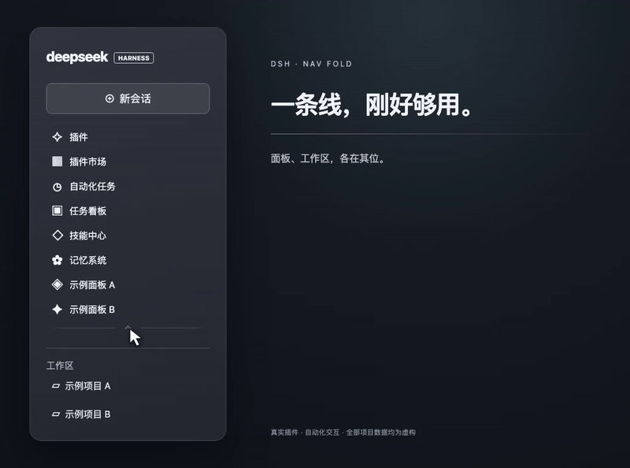
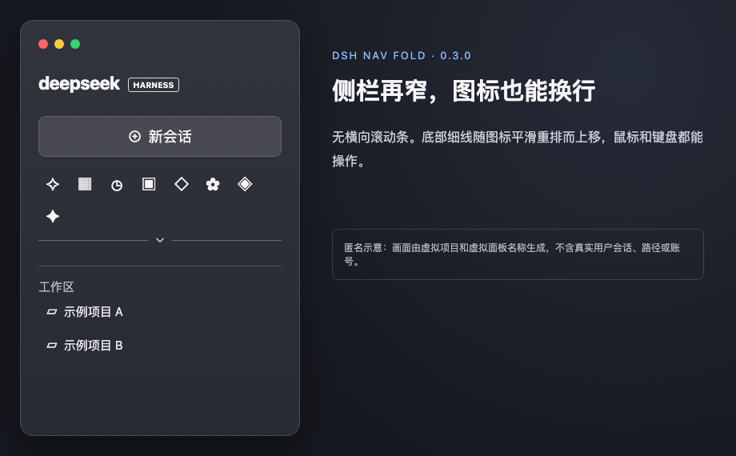
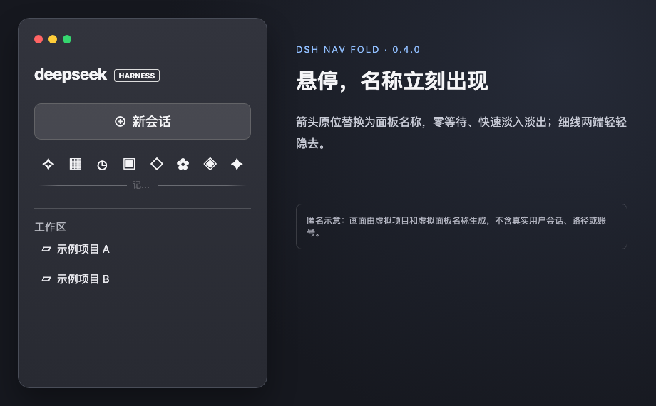
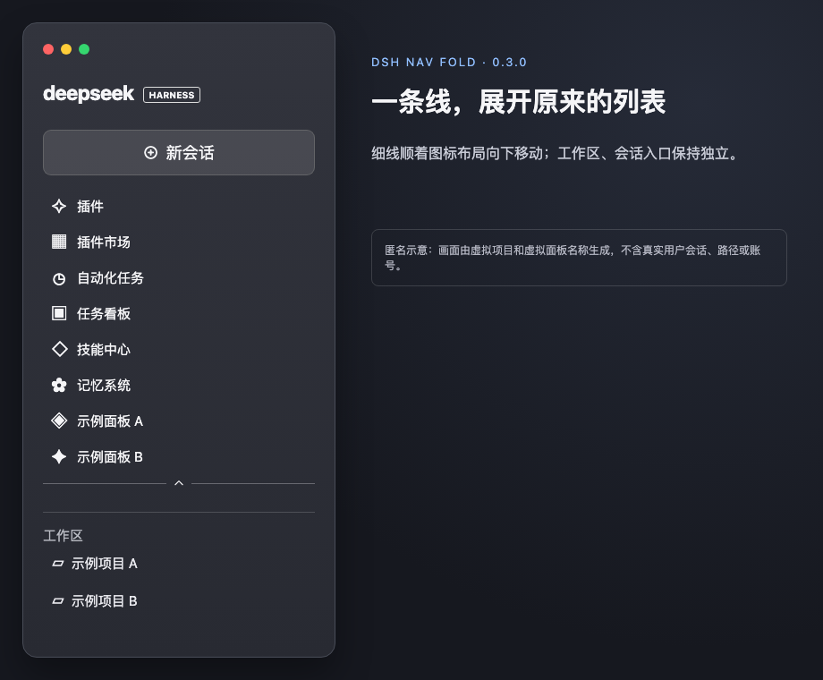
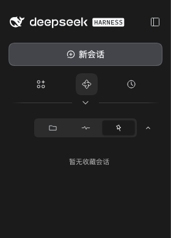
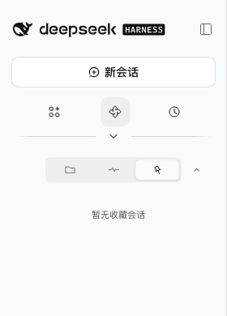
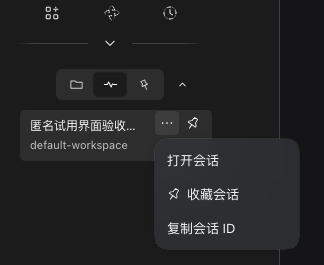
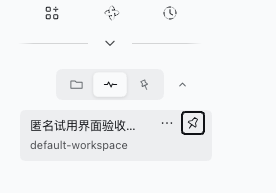

# dsh-nav-fold · v0.4.13-preview.4（本机试用，未发布）

> 一个插件整理 DSH 左侧栏：收起全局导航、按需开启工作区三栏，并用自定义入口快捷键进入文件夹／会话焦点导航。也可通过「无线麦」映射小米蓝牙遥控器按键；Fold 不直接连接蓝牙设备。macOS 顶部 Logo 隐藏功能收录并适配 [stoner-byte 的 dsh-hide-brand](https://github.com/stoner-byte/dsh-hide-brand)（MIT）。

**一条细线，收起全局导航。工作区视图，按需开启。**

点击侧栏导航底部，面板列表收成一排图标；再点一下，回到熟悉的列表。工作区与会话留在原位。



[观看高清演示 · 60fps MP4](https://github.com/nico-zhuang/dsh-nav-fold/releases/download/v0.4.1/dsh-nav-fold-demo.mp4)

## 安装与升级

**v0.4.12 安装：**从 [GitHub Release](https://github.com/nico-zhuang/dsh-nav-fold/releases/tag/v0.4.12) 下载 `dsh-nav-fold-0.4.12.tgz`，或用 DSH CLI 安装：

```sh
dsh plugin add https://github.com/nico-zhuang/dsh-nav-fold/releases/download/v0.4.12/dsh-nav-fold-0.4.12.tgz
```

已针对 **DSH 0.2.1-rc.5 与 0.2.2-rc.1** 两个已发布构建分别核对原生侧栏结构并做自动化回归；不代表 0.2.1 的所有子版本均已验证。升级后正常重启 DSH；三栏依旧**默认关闭**，若旧版安全隔离曾将其保存为关闭，需在插件配置中重新保存开启。上一公开版 [v0.4.11](https://github.com/nico-zhuang/dsh-nav-fold/releases/tag/v0.4.11) 保留下载与重装回退入口；这仍是 GitHub Release `.tgz` 发布，不是 npm 包发布。

## 左侧栏优化，按需开启

设置在 **插件 → 已安装 → dsh-nav-fold → 配置**，按用途分为两组；三个开关各自保存，不相互替代：

- **浏览与导航**：开启并保存「工作区／活动／收藏三栏」，再确认「会话焦点导航」已开启。到 **DSH 设置 → 快捷键**，给「会话导航 / Navigate sessions」绑定入口组合键（无预设）。进入后 ↑↓移动焦点，←→切换三栏；Enter 展开文件夹或打开会话，Esc 退出。需要遥控器时，可在「无线麦」中把小米蓝牙遥控器的“进入列表”按键映射到同一组合键；Fold 不负责设备配对。
- **空间整理**：可独立开启「隐藏顶部 Logo」（仅 macOS），不要求打开三栏。这项功能收录并适配 [stoner-byte 的 dsh-hide-brand](https://github.com/stoner-byte/dsh-hide-brand)，许可与来源见 [第三方声明](THIRD_PARTY_NOTICES.md)。

v0.4.12 仅将折叠导航细线和箭头的视觉内容上移 4px（CSS 像素），保留原有 24px 可聚焦点击区域、36px 图标行及会话列表可用高度；三栏 Tab 的外侧边距在 DSH 0.2.2-rc.1 为 4px、0.2.1-rc.5 为 2px，与各自原生「新会话」按钮的外边距一致，原生「新会话」按钮本身未改动。选中 Tab 的主题填色不变；DS Bot／Bridge 底部入口聚合仍仅在研究阶段，不属于此次改动。v0.4.11 曾让选中 Tab 使用随深浅主题调整的更柔和填色，并去掉折叠导航中宿主 8px 与 Fold 自身 6px 的重复上下间距；v0.4.10 在 rc.1 上把会话行三点操作交回 DSH 原生菜单，rc.5 保留旧版回退，不修改已保存偏好。已验证自动化行为测试；**v0.4.12 安装后的真实 DSH GUI 视觉验收尚未完成，新版菜单也尚无已认证的真实 DSH GUI 点击验收，实体遥控器组合操作未亲测**，不将源码或模拟测试称为现场验收。

## 交互，刚好够用

- **点一下**：展开或收起。图标与细线从当前位置平滑移动，连续点击也能立即反向。
- **停一下**：面板名称直接替换细线中央的箭头；移开后箭头回来。键盘聚焦图标时同样能看到名称，不必等待原生提示。
- **拖一下**：把常用图标移到顺手的位置，顺序保存在本机。也可以聚焦图标后按 `Alt + 方向键` 排序。

侧栏变宽或变窄时，图标由原生布局即时等距重排、自动换行；末行沿左侧列位对齐。点击展开或收起时仍有可中断的平滑动画，箭头低调呼吸，细线纤细淡出；系统选择「减少动态效果」时，移动与呼吸动画自动停止。新增的面板也会加入，不影响工作区和会话。

<details>
<summary>静态界面预览</summary>







</details>

> 动画与截图均在[匿名示意页](docs/preview.html)中运行真实插件生成；动画的指针输入由脚本驱动。项目和扩展面板名称为虚构数据，不包含真实会话或账号；实际图标由 DSH 与已安装插件提供。

## v0.4.3 新增：工作区／活动／收藏（默认关闭）

启用路径：**插件 → 已安装 → dsh-nav-fold → 配置 → 勾选「工作区／活动／收藏三栏」→ 保存三栏设置**。仅安装插件、点侧栏按钮或旧版浏览器偏好都不会替你打开三栏；配置尚未保存时仍显示 DSH 原生工作区。开启后，工作区沿用原生树，活动展示待处理／运行／近期会话，收藏读取 DSH 自身的置顶会话，不另建收藏数据。点击栏目不会切换当前打开的会话。重新关闭并保存后，插件的三栏和替代视图一起撤出，原生工作区立即回来。

**以下是 v0.4.3 历史设计，非当前版本布局**：三个 15px 线性图标居中，收藏为轻微斜置的 Pin；横框右侧曾有独立的 Tab 隐藏按钮，并以左侧留白平衡。该版本的折叠仅是浏览器显示偏好，不关闭活动／收藏视图。v0.4.7 已移除这个控件与旧本地偏好读取，改为下文的通栏布局。

| 历史示例（v0.4.3）· 深色收藏 | 历史示例（v0.4.3）· 浅色收藏 | 历史示例（v0.4.3）· 旧版收起 Tab 栏 |
| --- | --- | --- |
|  |  |  |

> 上述截图来自 **DSH 0.2.1-rc.5 匿名独立试验 profile 的真实界面**；其中没有个人会话，所以列表显示「暂无收藏会话」。本节与上方的匿名示意动图来源不同。

除仅影响活跃显示的「免打扰」小月亮外，活动行的真实工作状态只使用 DSH 的 `StateDot` 圆点：明确待处理为黄、运行中为蓝（轻微循环呼吸，减少动态效果时停用）、明确完成未读为绿；普通空闲不显示任何状态圆点，也不推断为错误。活动／收藏的当前主会话沿用 DSH 原生高亮主题；打开其他主面板时不误标为当前会话。

### 开发分支预览：活跃列表专属整理（未发布）

本机 **v0.4.13-preview.4** 在「活跃」提供「固定在顶部／取消顶部固定」、五种手动色标和「免打扰」。顶部固定的行在「顶部固定」分组标题下遵循本轮优先级排列，普通行留在分隔线后；没有顶部行就没有空分组。它只改变活跃列表的排序及近期 20 条上限，不等于 DSH 原生「置顶会话」，也不会加入「收藏」。整理菜单在文字右侧用向上箭头／小月亮区分两种动作，六个色标按钮按两行三列摆放（无色、青蓝、钴蓝／靛蓝、雾紫、银灰），点已选颜色可清除；人工色标避开任务状态使用的红、黄、绿。3px 左侧色条上下各留 4px，亮色主题使用更饱和的冷色，深色主题用柔和的对应色；Quiet 行色条仍可辨。已有 Host v1 色标槽位与其它偏好不重写，preview.3 原安装包及其旧色彩表现可作为回滚入口。

完成未读（绿点）会话从活跃列表点开后，本轮浏览暂时保留它在原绿灯队列中的位置，真实已读状态与绿点立即更新，不会因为落到近期 20 条之外而突然消失；连续打开多条也按本轮原顺序保留。新审批、重新运行以及人工固定在顶部仍立即按真实状态排序；离开活跃列表再进入时按当前 Host 状态重排，并恢复近期上限。这个浏览期位置只在内存中，不更改通知或 Host 未读位。

免打扰只把该活跃行置灰并显示小月亮，仍留在原本位置，可直接打开或从行内菜单取消。它**不会停止任务，也不会关闭 DSH 通知或审批提醒**，收藏和宿主原生菜单保持不变，不再有顶部「免打扰管理」。活跃偏好保存在 DSH 当前 profile 的 Host 配置中，正常重启或 localhost 端口改变后可从该 profile 恢复；不会跨设备同步。旧版浏览器缓存没有 profile 标识，**不会自动导入**：仅当 Host 尚未初始化且当前端口能读到旧缓存时，活跃列表末尾会提示「导入旧偏好」及跨配置风险；确认该缓存属于当前 profile 后才点导入。导入成功后不再重复提示，旧缓存仍保留以便回滚；旧端口不可访问的数据无法自动找回。不开启三栏时功能不露出；当前公开 v0.4.12 Release 不包含这些功能，真实已认证 DSH GUI 点击验收仍待完成。

### 会话悬停操作（v0.4.12 已发布行为）

活动和收藏会话行在鼠标悬停或键盘聚焦时显示操作按钮；触屏不依赖悬停。在支持公开会话上下文菜单的 DSH 0.2.2-rc.1 中，每行只有一个三点按钮，标题只为该按钮留位；点击三点、右键或 Shift+F10 均打开 DSH 共享的原生会话菜单，不会切换当前会话。置顶／取消置顶、重命名、分叉、复制 ID、归档及运行中归档的权限与确认流程均由宿主处理，Fold 不再绘制独立 Pin／归档按钮或自己的菜单。

在尚无完整公开菜单入口的 DSH 0.2.1-rc.5 中，仍保留原有三点、Pin、归档三个按钮及 82px 标题留位；Pin／归档调用 DSH `uiWorkspace` 接口，失败提示重试，不另存收藏数据。此兼容菜单并非宿主完整右键菜单，不提供原生重命名／分叉。下方 v0.4.4 截图仅展示 rc.5 的历史布局，不代表 rc.1 的单按钮布局。

| 深色 · 三点菜单 | 浅色 · 会话 Pin |
| --- | --- |
|  |  |

> 截图来自 DSH 0.2.1-rc.5 匿名独立 Host 中的非空试验会话，220px 模拟会话列宽；测试环境不含个人会话或模型密钥。

### v0.4.5 历史兼容路径：DSH 0.2.1-rc.5 的活动与收藏会话归档

以下仅描述 DSH 0.2.1-rc.5 的旧版回退行为：活动和收藏行有独立归档按钮，三点菜单也提供归档；两者均调用 DSH 原生 `uiWorkspace.archiveSession`，不跳转、不直接改写会话文件或自建归档状态。请求成功后仍等待宿主更新 `archivedSessionIds` 才移除行，不提前假装归档成功。请求中阻止重复提交及并发 Pin；普通失败保留会话并提示重试。

在此 rc.5 回退路径中，如果宿主明确拒绝归档运行中的会话，Fold 才显示「归档并停止」确认；取消不停止任务，确认后才调用 `archiveSession(id, { stopActivity: true })`。确认失败时保留弹窗及错误提示供重试；缺失归档 API 时按钮不可用，不猜测其他停止或删除路径。**此运行中路径仅经过模拟测试，未用真实模型密钥或真实运行任务验收。**

### v0.4.7：快捷键驱动的会话焦点导航

Fold 不直接连接蓝牙设备，而是使用 DSH 已有快捷键：在 **插件 → 已安装 → dsh-nav-fold → 配置** 保存启用「工作区／活动／收藏三栏」并确认「会话焦点导航」开关已启用，再到 **DSH 设置 → 快捷键 → 会话导航 / Navigate sessions** 自行分配入口组合键；将小米蓝牙遥控器通过「无线麦」的“进入列表”按键映射到该组合键。Fold 没有预设快捷键，不修改「无线麦」或遥控器配置；绑定前检查 DSH 已注册命令冲突，并留意其他插件自行监听的全局按键。

进入导航后，↑↓移动当前栏中可见文件夹或会话的真实键盘焦点，**不会自动打开会话**；←→切换「工作区／活动／收藏」；Enter 在会话上才打开它，在工作区原生文件夹上则调用宿主原有点击来展开／收起并保留导航焦点；Esc 退出并尽可能回到进入前的焦点。折叠文件夹的隐藏子项不会进入遍历。编辑框、弹窗以及 DS-Bot 占用侧栏时不抢走方向键；原有 `Alt + 方向键` 面板排序不受影响。关闭会话导航开关会退出焦点模式并释放 Fold 的命令注册，保留三栏和用户在 DSH 中的快捷键绑定。实体小米遥控器与当前 DSH GUI 的整套组合操作仍需维护者亲测。

### v0.4.7：通栏三栏与节省空间的去 Logo 开关

三个 Tab 不再有右侧隐藏按钮，也不读取旧版的“折叠 Tab”本地偏好；启用三栏后保持可见，沿用原生侧栏内容宽度，与「新会话」约等宽。侧栏自身折叠成 rail 时仍由 DSH 原生布局隐藏三栏。上面的 v0.4.3 截图是历史示例，**不代表当前通栏样式**。

「隐藏顶部 Logo」是 Fold 中独立保存的开关，默认关闭，**无需开启三栏也能使用**。Fold 在 macOS 仅隐藏顶部纯展示的鲸鱼／字标行，让「新会话」上移，为会话列表留出空间；关闭开关或停用 Fold 后移除自身样式。该功能**收录并适配 [stoner-byte 的 dsh-hide-brand](https://github.com/stoner-byte/dsh-hide-brand) 去品牌行实现**：沿用上游 `logoRow` 类名片段和一次性样式注入思路，增加 Fold 自己的设置、macOS 限定及节点所有权清理；不捆绑或依赖整套上游插件，来源与 MIT 许可见 [第三方声明](THIRD_PARTY_NOTICES.md)。若同时启用原版 dsh-hide-brand，其常驻样式仍会隐藏 Logo，Fold 单独关闭开关无法让 Logo 显示回来。其他平台的品牌行可能有交互控件，Fold 不隐藏；真实 DSH GUI 的新版布局与显隐仍需现场验收。

## 兼容与边界

- DSH 0.2.1-rc.5 与 0.2.2-rc.1 的 `sidebar.workspaces` 都是只能渲染一个占用者的官方 slot。插件只在活动／收藏临时注册自己的替代视图，原生工作区节点不移走、不删除；开关关闭时注销自己的 slot、DOM 和监听器。已验证原生项与第三方临时竞争时，仅在运行时撤出自身视图和控件，不保存关闭；原生注册簿暂时为空或宿主 region/footer 短暂缺失且自身栏完好时也只运行时撤出。宿主恢复且自身注册确认成为唯一优先占用者后才显示控件并恢复原选视图。宿主 slot／原生身份或插件栏 DOM 结构异常仍硬隔离：撤出自身并尝试将后台设置保存为关闭，须在设置页手动保存开启后重试，不触碰其他插件节点。原生注册者身份按两个已发布构建各自的明确结构校验；未知构建不猜测接管。
- 自动检测不能识别任意插件私有的全局 CSS 或恶意 DOM 修改，因此不声称与所有未来插件百分百无冲突；未知宿主结构默认展示原生工作区，不尝试强行接管。
- 活动按待处理、运行中、明确未读的完成项及最近会话排序；普通空闲不假装完成或出错。收藏取自 DSH 的 `pinnedSessionIds`；空白、归档和子代理会话不进入普通列表。点击会话委托 DSH 原生 `uiWorkspace.openSession`；rc.1 的会话菜单及归档由 DSH 原生处理，rc.5 兼容回退的归档仍委托 `uiWorkspace.archiveSession` 并以宿主快照为准。
- Host 配置 `workspaceViewsEnabled` 默认为 false，旧试用版 localStorage 中的 `on` 不会绕过它；Tab 选择仍仅存本浏览器本地。不会写入会话正文或工作区文件，导航折叠/顺序的旧本地键保持兼容。
- v0.4.3 的工作区三栏、v0.4.4 的悬停会话操作与 v0.4.5 的归档安全路径原本基于 DSH 0.2.1-rc.5 的已发布构建；v0.4.9 增加按 DSH 0.2.2-rc.1 原生结构制作的兼容回归，v0.4.10 在 rc.1 上复用原生会话菜单。rc.5 回退路径中运行中真实模型会话的归档仅经过模拟测试。其他 Host 版本或未知侧栏结构会安全保持原生工作区，不承诺与所有第三方私有 CSS/DOM 百分百无冲突。原全局导航折叠与置顶会话仍沿用本机现有偏好；升级不会清理用户数据。自动化测试不能替代新设置页和侧栏的真实宿主 GUI 验收。

开发验证：Node.js 20+ 运行 `npm ci --legacy-peer-deps && npm test`。jsdom、React 与 Schemastery 仅用于本仓测试；`@deepseek-ai/cordis` 是 DSH 宿主提供的 peer，不随 GitHub 安装包打入。
