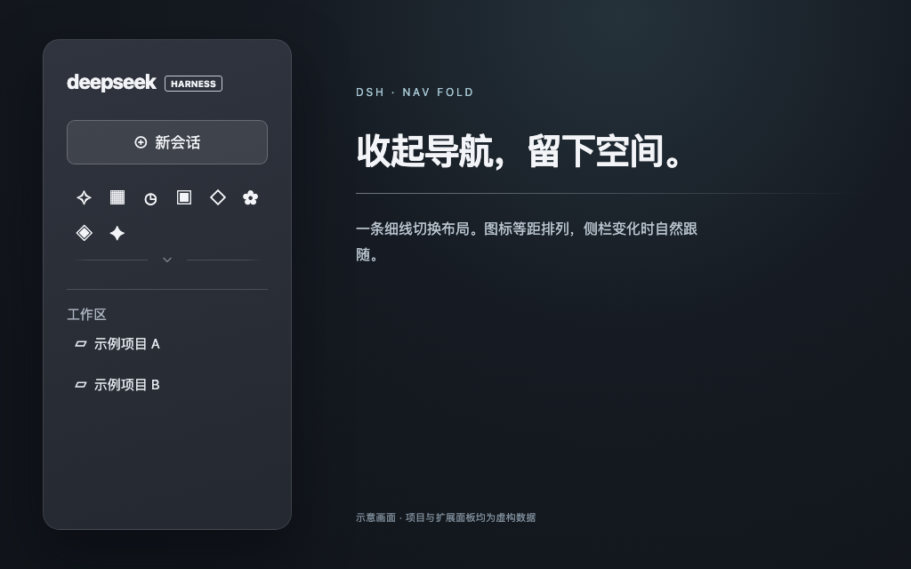
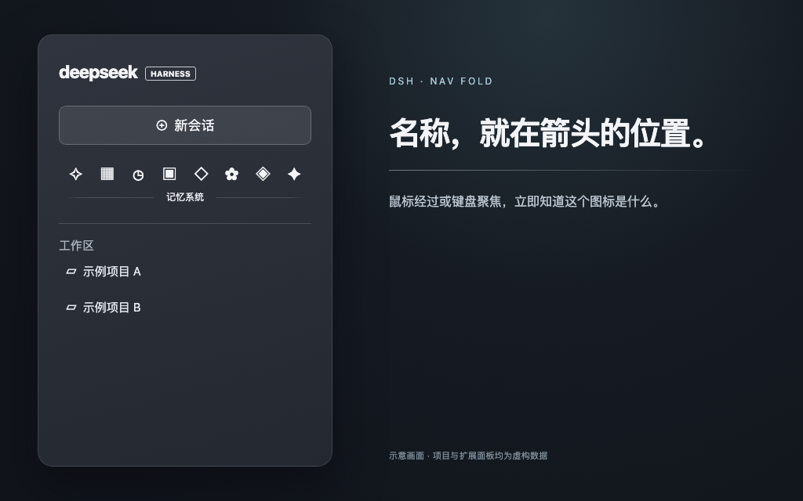
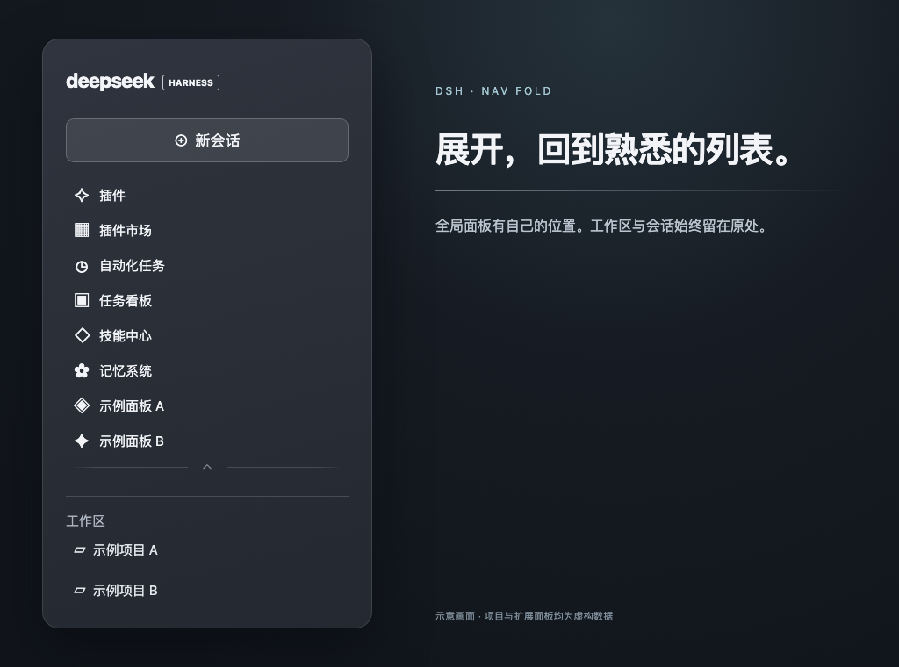

# dsh-nav-fold

**一条细线，收起全局导航。**

点击侧栏导航底部，面板列表收成一排图标；再点一下，回到熟悉的列表。工作区与会话留在原位。

## 交互，刚好够用

- **点一下**：展开或收起。图标与细线从当前位置平滑移动，连续点击也能立即反向。
- **停一下**：面板名称直接替换细线中央的箭头；移开后箭头回来。键盘聚焦图标时同样能看到名称，没有延迟弹出的原生提示。
- **拖一下**：把常用图标移到顺手的位置，顺序保存在本机。也可以聚焦图标后按 `Alt + 方向键` 排序。

侧栏变宽或变窄时，图标等距排列、自动换行；末行沿左侧列位对齐，移动带一点轻微回弹。箭头低调呼吸，细线纤细淡出；系统选择「减少动态效果」时，移动与呼吸动画自动停止。新增的面板也会加入，不影响工作区和会话。

> 以上画面由[匿名示意页](docs/preview.html)生成。项目和扩展面板名称为虚构数据；实际图标由 DSH 与已安装插件提供。

## 安装

在 DSH 桌面端「插件 → 添加插件」中，填写[最新 Release](https://github.com/nico-zhuang/dsh-nav-fold/releases/latest) 下载的 `.tgz` 文件**绝对路径**并启用；也可以填写仓库 Git 地址。无需额外运行时依赖或手动修改桌面 profile。

## 兼容与边界

- 已适配 DeepSeek Harness `0.2.1-rc.2`；仅作用于中英文「全局面板」，DSH 升级后建议复测。
- 排序保存在当前设备的浏览器中，不跨设备同步；面板重名或改名后可能恢复默认顺序。
- 禁用插件会移除注入的界面和事件；面板节点由 DSH 提供，插件不会修改工作区或会话。

开发验证：`npm test`（测试依赖本地相邻项目已有的 jsdom，不包含在安装包中）。
